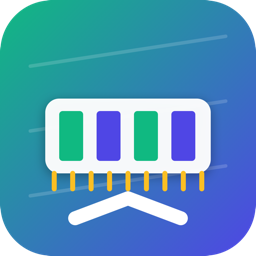

<h1 align="center">Memory Bandwidth Bench</h1>

A single-file SwiftUI app that measures memory bandwidth on Apple Silicon (and Intel) Macs.

A macOS GUI app that measures real memory bandwidth and compares it against Apple's official spec, with automatic UI language detection (Traditional Chinese / Simplified Chinese / English).

## Build & Run

    ./build.sh
    open MemoryBandwidthBench.app

`build.sh` compiles `main.swift`, refreshes the `.app` bundle, and ad-hoc signs it. Requires macOS 13+ and Xcode Command Line Tools.

## Release

    ./release.sh          # patch bump: 1.0.4 -> 1.0.5
    ./release.sh minor    # 1.0.4 -> 1.1.0
    ./release.sh major    # 1.0.4 -> 2.0.0

The git tag is the single source of truth. One command bumps the version, rebuilds, packages the DMG, pushes the tag, and publishes a GitHub Release with the DMG attached.

## Tests

| Test | Description |
|---|---|
| Read | Each thread scans its own buffer, 8-way unrolled uint64 accumulation to raise outstanding requests |
| Write | 8-way unrolled stores into the same buffer (results may be absorbed by caches) |
| Write (ping-pong) | Alternates two buffers each iteration so dirty lines must be evicted, closer to sustained DRAM write bandwidth |
| Copy | memcpy; traffic counts both read and write bytes |
| CPU+GPU concurrent | All CPU threads scan while a Metal kernel reads at the same time; the total is closest to the SoC ceiling |

## Official spec baseline

- The app matches `machdep.cpu.brand_string` against a built-in table of Apple official specs (M1 through M5 families) and shows the official bandwidth next to your results, with an orange dashed baseline in the chart and a "% of official" column (also exported to CSV).
- Bandwidth varies by configuration within a family (e.g. M5 Max: 32-core GPU = 460 GB/s, 40-core GPU = 614 GB/s). The app reads `gpu-core-count` from IORegistry to pick the right number automatically; if unavailable it falls back to showing both. M5 is resolved by RAM size (16 GB = 153, 24/32 GB = 170).
- Numbers come from Apple's official tech-spec pages; always check apple.com for the authoritative values.

## Measurement notes

- Sizes below L2 (16/64 MB) are absorbed by cache and read far above real DRAM bandwidth; use 256 MB or more to measure DRAM.
- Bandwidth is affected by App Nap, other apps, and thermals; the app holds a power assertion during tests to avoid downclocking.
- CPU-only reads are bound by Little's Law (outstanding requests x 64 B / latency) and typically reach ~50% of theoretical peak; CPU+GPU concurrent reaches ~75-80%. The 200 GB/s figure for M1 Pro is the LPDDR bus theoretical peak.
- "Peak" is the best of the timed iterations; each iteration auto-repeats to fill a 20 ms timing window and reduce scheduling jitter.

## License

MIT. See [LICENSE](LICENSE).

## Language / 語系

The UI detects the system language at launch: Traditional Chinese (zh-Hant), Simplified Chinese (zh-Hans, converted automatically via CoreText), or English. The app title always carries the version suffix (e.g. "Memory Bandwidth Bench v1.0.5").

---

## 中文說明

單檔 SwiftUI 應用程式，在 Apple Silicon（及 Intel）Mac 上量測真實記憶體頻寬，並與 Apple 官方規格對照。介面語系自動偵測（繁中／简中／英文）。

### 建置與執行

    ./build.sh
    open MemoryBandwidthBench.app

`build.sh` 會編譯 `main.swift`、更新 `.app` bundle 並做 ad-hoc 簽章。需要 macOS 13+ 與 Xcode Command Line Tools。

### 發布新版本

    ./release.sh          # patch：1.0.4 -> 1.0.5
    ./release.sh minor   # 1.0.4 -> 1.1.0
    ./release.sh major   # 1.0.4 -> 2.0.0

版號唯一來源是 git tag。一條指令完成：累進版號、編譯、打包 DMG、推 tag、發布 GitHub Release。

### 測試項目

| 項目 | 說明 |
|---|---|
| 讀取 | 每個執行緒掃描自己那片 buffer，8 路展開 uint64 累加，提高在途請求數 |
| 寫入 | 8 路展開填滿 buffer（會重複寫同一塊，數據可能受快取吸附影響） |
| 寫入(乒乓) | 每次迭代交替寫兩塊 buffer，強迫上一輪髒資料在本輪逐出，較貼近 DRAM 持續寫入 |
| 複製 | memcpy，流量計入讀＋寫雙向位元組 |
| CPU+GPU併發 | CPU 全執行緒掃描的同時，Metal kernel 讓 GPU 一起讀取；合計值最接近整機上限 |

### 原廠規格對照

- App 依 `machdep.cpu.brand_string` 自動匹配內建規格表（M1～M5 全系），顯示原廠頻寬、圖表橘色虛線基準與「達原廠 %」欄（CSV 亦含）。
- 同家族不同配置頻寬不同（例如 M5 Max：32 核 GPU＝460 GB/s、40 核 GPU＝614 GB/s）。App 從 IORegistry 讀取 `gpu-core-count` 自動判定；讀不到時退回顯示兩個數字。M5 依記憶體容量判定（16GB＝153、24／32GB＝170）。
- 數字取自 Apple 官方技術規格頁；實際以 apple.com 為準。

### 量測注意事項

- 小於 L2 的尺寸（16／64 MB）會被快取吸收，數字遠高於 DRAM 頻寬；要看 DRAM 請用 256 MB 以上。
- 頻寬受 App Nap、其他 App 負載、溫度影響；測試期間持有電源斷言避免降頻。
- CPU 端讀取受 Little's Law 限制，通常約為理論峰值 5 成；CPU＋GPU 併發約 75–80%。
- 「峰值」是各次迭代中最好的一次；每次迭代自動重複以湊滿 20 ms 計時窗、壓低排程誤差。

### 授權

MIT，詳見 [LICENSE](LICENSE)。

### 簽章提醒

Ad-hoc 簽章、未經 Apple 公證。本機使用請在首次開啟時對 app 按兩下選「打開」；經瀏覽器或郵件下載分發給他人時可能被 Gatekeeper 阻擋。

## Files

- `main.swift` — all source (UI + measurement core + Metal kernel)
- `LICENSE` — MIT
- `build.sh` — build script
- `make_dmg.sh` — package the DMG (drag-to-install)
- `release.sh` — version bump + build + DMG + tag + GitHub Release
- `tools-icon-render.swift` — app icon renderer (CoreGraphics; outputs icons/icon-A/B/C.png)
- `icons/` — 1024x1024 icon sources (the app uses style C)
