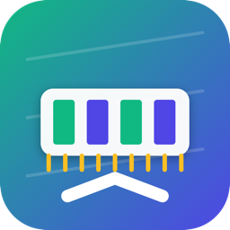

<h1 align="center">Memory Bandwidth Bench</h1>

A macOS GUI app that measures real memory bandwidth and compares it against Apple's official spec.

## Build & Run

    ./build.sh
    open MemoryBandwidthBench.app

`build.sh` compiles `main.swift`, refreshes the `.app` bundle, and ad-hoc signs it. Requires macOS 13+ and Xcode Command Line Tools.

For a headless smoke test (used by CI): build with `swiftc -O -parse-as-library main.swift -o MemoryBandwidthBench` and run `./MemoryBandwidthBench --self-test`.

## Release

    ./release.sh          # patch bump: 1.0.7 -> 1.0.8
    ./release.sh minor    # 1.0.7 -> 1.1.0
    ./release.sh major    # 1.0.7 -> 2.0.0

The git tag is the single source of truth. One command bumps the version, rebuilds, packages the DMG, pushes the tag, and publishes a GitHub Release with the DMG attached.

## Tests

| Test | Description |
|---|---|
| Read | Each thread scans its own buffer, 8-way unrolled uint64 accumulation to raise outstanding requests |
| Write | 8-way unrolled stores into the same buffer (results may be absorbed by caches) |
| Write (ping-pong) | Alternates two buffers each iteration so dirty lines must be evicted, closer to sustained DRAM write bandwidth |
| Copy | memcpy; traffic counts both read and write bytes |
| CPU+GPU concurrent | All CPU threads scan while a Metal kernel reads at the same time; the total is closest to the SoC ceiling |
| GPU-only | A Metal kernel reads at full throttle with pipelined command buffers; a single master pushing the bus near saturation |

## Official spec baseline

- The app matches `machdep.cpu.brand_string` against a built-in table of Apple official specs (M1 through M5 families) and shows the official bandwidth next to your results, with an orange dashed baseline in the chart and a "% of official" column (also exported to CSV).
- Bandwidth varies by configuration within a family (e.g. M5 Max: 32-core GPU = 460 GB/s, 40-core GPU = 614 GB/s). The app reads `gpu-core-count` from IORegistry to pick the right number automatically; if unavailable it falls back to showing both. M5 is resolved by RAM size (16 GB = 153, 24/32 GB = 170).
- Numbers come from Apple's official tech-spec pages; always check apple.com for the authoritative values.

## Measurement notes

- Sizes below L2 (16/64 MB) are absorbed by cache and read far above real DRAM bandwidth; use 256 MB or more to measure DRAM.
- Bandwidth is affected by App Nap, other apps, and thermals; the app holds a power assertion during tests to avoid downclocking.
- CPU-only reads are bound by Little's Law (outstanding requests x 64 B / latency) and typically reach ~50% of theoretical peak. Adding GPU traffic pushes the total to ~75-80%, and the GPU alone reaches the same range on its own; the remaining gap is DRAM refresh and read/write turnaround. The 200 GB/s figure for M1 Pro is the LPDDR bus theoretical peak.
- "Peak" is the best of the timed iterations; each iteration auto-repeats to fill a 20 ms timing window and reduce scheduling jitter.

## Language

The UI is English. The app title always carries the version suffix (e.g. "Memory Bandwidth Bench v1.0.8").

## License

MIT. See [LICENSE](LICENSE).

## Files

- `main.swift` — all source (UI + measurement core + Metal kernel)
- `LICENSE` — MIT
- `build.sh` — build script
- `make_dmg.sh` — package the DMG (drag-to-install)
- `release.sh` — version bump + build + DMG + tag + GitHub Release
- `tools-icon-render.swift` — app icon renderer (CoreGraphics; outputs icons/icon-A/B/C.png)
- `icons/` — 1024x1024 icon sources (the app uses style C)
